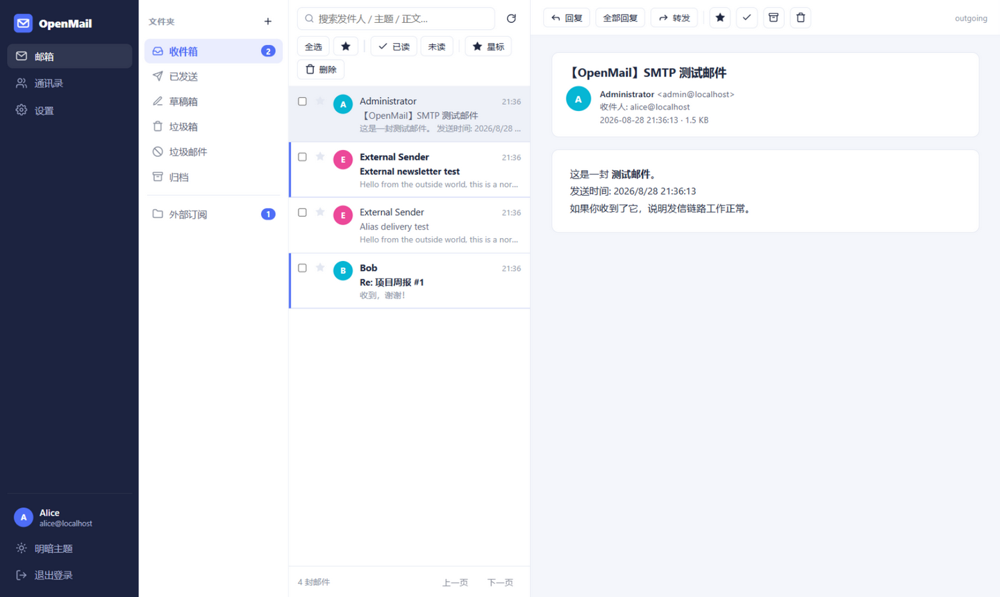
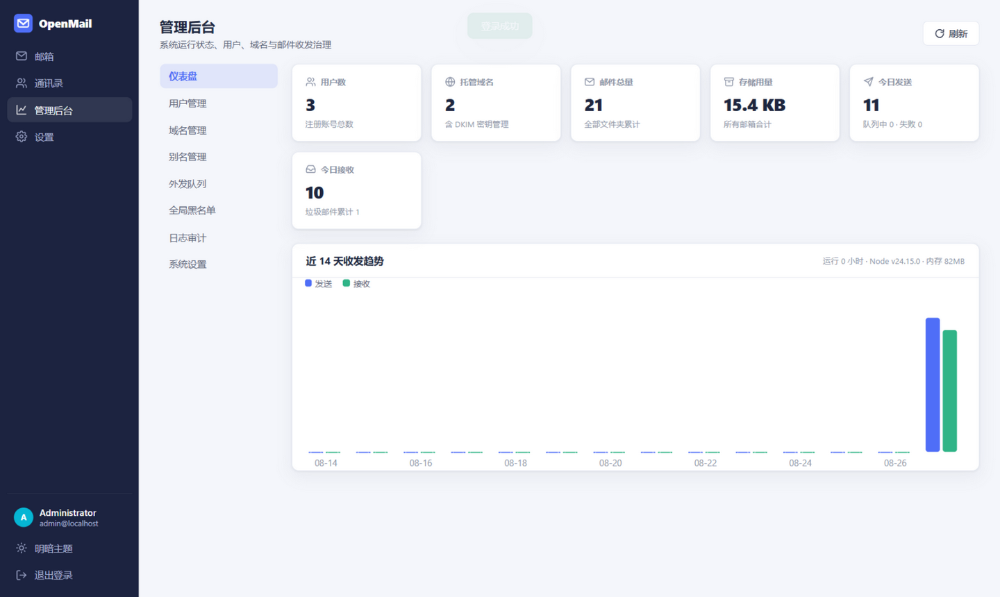
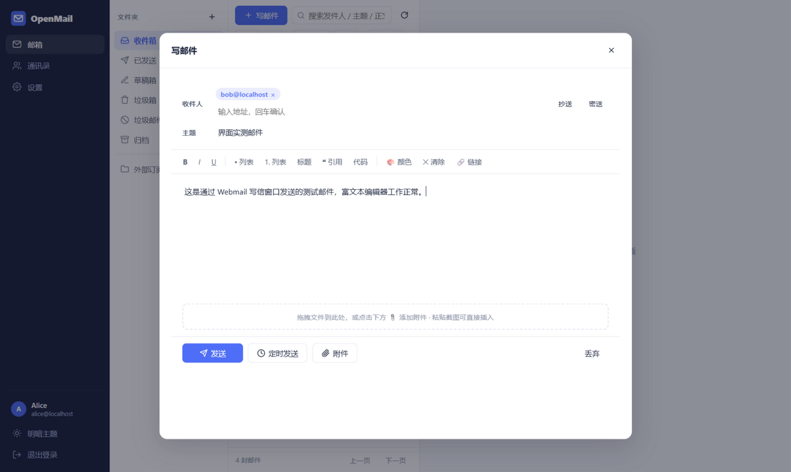
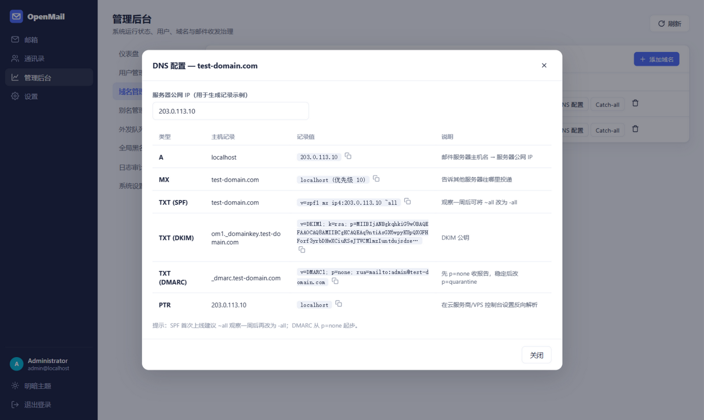
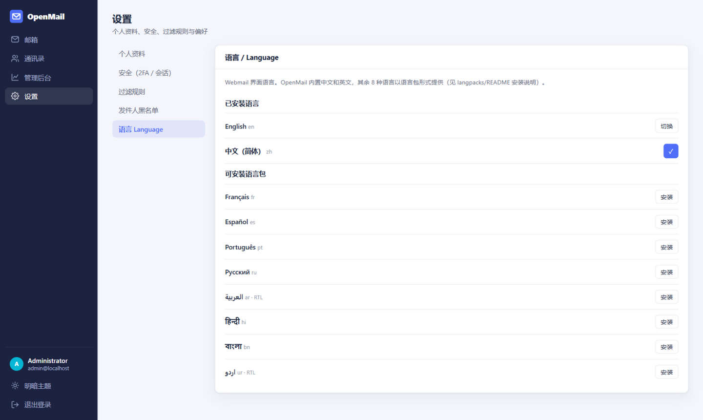
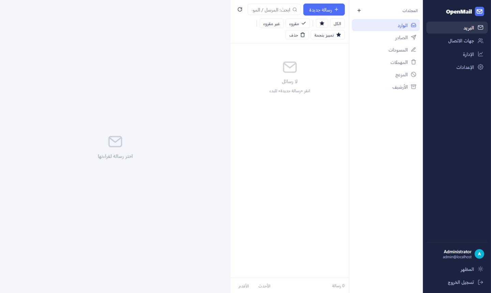

# OpenMail

**一个进程跑起来的自托管开源邮件服务器套件** —— 基于 Node.js，内置 SMTP / IMAP / POP3 全协议、三栏式 Webmail、管理员后台、多域名多租户、DKIM、反垃圾与 2FA 双因素认证。零原生依赖，一个 SQLite 文件，几分钟即可上线。

<p>
  
  
</p>
<p>
  
  
</p>

[English Documentation](README.md)

---

## 项目定位

主流自托管邮件方案需要拼装十几个守护进程（Postfix、Dovecot、Rspamd、Redis、MySQL……）。OpenMail 反其道而行之，是一个**刻意保持简单的单体邮件平台**，纯 JavaScript 实现：

- **一个进程**同时提供 SMTP（MX + Submission + SMTPS）、IMAP/IMAPS、POP3/POP3S、HTTP API 与 Webmail 界面。
- **零原生模块** —— 数据库使用 Node.js 22+ 内置的 `node:sqlite`，加密全部纯 JS。Windows / Linux / macOS / ARM64 数秒装完。
- **真实协议** —— Thunderbird、Apple Mail、Outlook 等客户端开箱即连。
- **默认即安全** —— 每个域名自动生成 DKIM 密钥、管理后台一键展示 DNS 记录、内置反垃圾评分。

适合个人邮箱、小团队、家庭实验室（Homelab），以及作为学习邮件系统原理的可读代码库。

## 功能矩阵

### 邮件
| 功能 | 说明 |
| --- | --- |
| 邮件收发 | 入站 SMTP（25 端口 MX）、SASL 认证 Submission（587）、隐式 TLS SMTPS（465）；一实例多账户 |
| 邮件操作 | 读 / 写 / 回复 / 全部回复 / 转发；多选批量移动、删除、加星、已读 |
| 草稿与定时 | 服务端每 12 秒自动保存草稿；定时发送由内置调度器到点投递 |
| 附件管理 | 上传 / 下载 / 预览；拖拽上传；**截图可直接粘贴进正文**；CID 内嵌图片 |
| 邮件搜索 | 发件人 / 收件人 / 主题 / 正文全文检索；文件夹内或全库搜索 |
| 邮件分类 | 系统文件夹 + 自定义文件夹；星标；未读过滤；**邮件可拖拽到文件夹** |
| 会话线程 | 按 `References` / `In-Reply-To` / 规范化主题聚合对话 |
| 归档清理 | 一键归档已读邮件；清空垃圾箱 / 垃圾邮件 |
| **AI 助手** | 自配任意 **OpenAI 兼容接口**（接口地址 + 模型 + API Key，AES 加密存于服务端）：**帮写邮件**（语气可选）、一键**翻译邮件**（12 种目标语言）、**AI 分析邮件**（摘要 / 要点 / 待办 / 回复建议） |
| **邮件模板** | 常用邮件存为模板；**导入 HTML 模板**（文件或粘贴）或 **AI 生成模板**；写信时一键插入 |

### 通讯录
增删改查、分组、搜索、**vCard 与 CSV 导入导出**、收件人自动补全（联系人 + 本域用户）、从联系人快速写信。

### 账户与安全
| 功能 | 说明 |
| --- | --- |
| 登录认证 | 邮箱 + 密码（bcrypt 哈希），可选开放注册 + 注册审批码 |
| 双因素 2FA | TOTP（RFC 6238），扫码绑定，兼容 Google Authenticator |
| 会话管理 | 多设备会话列表、单独 / 批量撤销、有效期可配 |
| 权限体系 | `admin` / `user` / `temp` 三级角色，服务端逐路由校验（RBAC） |
| 操作审计 | 登录、失败登录、发信、管理操作、投递记录，全部带 IP 落库 |

### 域名与多租户
一实例多域名 · 邮箱容量配额 · 别名转发 · **域名级 Catch-all** · 自动生成 2048 位 DKIM 密钥并展示可复制的 DNS 记录。

### 管理员后台
实时统计与近 14 天收发图表 · 用户增删改 / 封禁 / 配额 / 重置密码 · 域名与 DKIM 管理 · 别名管理 · 外发队列检查器 · 全局黑名单 · 审计日志浏览器 · SMTP 发信测试 · 一键 SQLite 备份下载。

### 反垃圾与邮件认证
- 入站邮件自动进行 **SPF / DKIM / DMARC** 认证（`mailauth`）
- 规则式**垃圾评分**（认证失败、关键词、HELO 检查等）→ 自动进垃圾文件夹，支持 SMTP 阶段直接拒收
- 外发邮件自动用各域名密钥做 **DKIM 签名**
- 用户级 + 全局发件人黑名单
- 全部 SMTP 端口按 IP 限流

### 协议支持
| 协议 | 开发端口 | 生产端口 | 用途 |
| --- | --- | --- | --- |
| SMTP (MX) | 2525 | **25** | 服务器间投递 |
| Submission | 2587 | **587** | 用户发信（SASL 认证 + STARTTLS） |
| SMTPS | 2546 | **465** | 隐式 TLS 发信 |
| IMAP | 1143 | **143** | 邮件拉取 |
| IMAPS | 1993 | **993** | 隐式 TLS 拉取 |
| POP3 | 1110 | **110** | 邮件下载 |
| POP3S | 1995 | **995** | 隐式 TLS 下载 |
| HTTP | 3000 | 反代 443 | Webmail / 管理后台 / REST API |

> IMAP/POP3 服务端为刻意精简的实现（LOGIN、LIST、SELECT、FETCH、STORE、SEARCH、APPEND、IDLE、MOVE 等）—— 满足日常客户端使用，并非完整 RFC 3501 实现。

## 安装方式（四种任选）

| 方式 | 命令 / 入口 | 适合 |
| --- | --- | --- |
| **一键脚本** | `curl -fsSL https://raw.githubusercontent.com/chenyuwebwawa/OpenMail/main/install.sh \| bash` | 全新 Linux VPS（自动装 Node 22 + 源码 + systemd + 语言包） |
| **Docker** | `docker compose up -d --build`（源码构建）· `ghcr.io/chenyuwebwawa/openmail:latest`（预构建） | 有 Docker / 1Panel 的服务器 |
| **普通服务器手动安装** | `git clone && npm install && npm start` | 开发环境、Windows（`start-windows.bat` 双击启动） |
| **运维面板** | 宝塔面板指南 · 1Panel 指南 | 已用面板管理的服务器 |

### 1. 一键安装（Linux 服务器）

```bash
# 交互式：询问域名、生成 .env、注册 systemd 服务、安装 10 语言包并打印管理员密码
curl -fsSL https://raw.githubusercontent.com/chenyuwebwawa/OpenMail/main/install.sh | bash

# 国内网络 404/超时时，任选其一：
curl -fsSL https://cdn.jsdelivr.net/gh/chenyuwebwawa/OpenMail@main/install.sh | bash
git clone https://github.com/chenyuwebwawa/OpenMail.git /opt/openmail && cd /opt/openmail && bash install.sh

# 非交互带参数:
bash install.sh --domain example.com --standard-ports --dir /opt/openmail
```

**以后更新** —— 服务器上一条命令（自动备份数据、快照运行文件、拉取最新代码、装依赖、重启）：

```bash
cd /opt/openmail && bash scripts/update.sh      # 加 --check 只查看新版本
```

参数：`--domain`（邮件域名）、`--standard-ports`（使用 25/587 标准端口而非开发端口）、`--port`（HTTP 端口）、`--dir`（安装目录）。服务以非 root 用户经 systemd 运行（`systemctl status openmail`）。

### 2. Docker 安装

OpenMail 是**单容器**应用 —— SQLite 与附件放在 bind mount 中，无需其它 sidecar 容器。镜像有两种获取方式：

**方式 A —— 源码构建（推荐，任何环境都可用）：**

```bash
git clone https://github.com/chenyuwebwawa/OpenMail.git && cd OpenMail
cp .env.example .env                # 设置域名 / 对外地址 / 中继 / TLS
docker compose up -d --build
```

`docker-compose.yml` 会通过 `${VAR:-默认值}` 读取 `.env` 中的全部 `OM_*` 配置（不再硬编码）；数据库、自动生成的 `secret.key` 与 `admin-credentials.txt` 持久化在 `./data`，附件在 `./files`。管理员初始密码会在首次启动时打印，同时写入 `data/admin-credentials.txt`。

**方式 B —— 预构建镜像（由 GitHub Actions 自动发布到 GHCR）：**

[`Docker Image` workflow](.github/workflows/docker-publish.yml) 会在 push 到 `main`、打 `v*` 标签以及手动触发时，构建 `linux/amd64` / `linux/arm64` 双架构镜像并推送到 `ghcr.io/chenyuwebwawa/openmail`：

```bash
# 如果 package 是 private，需要先登录（PAT 勾选 read:packages）：
# docker login ghcr.io -u <github 用户名>
docker pull ghcr.io/chenyuwebwawa/openmail:latest

docker run -d --name openmail --restart unless-stopped \
  -p 3000:3000 -p 25:25 -p 587:587 -p 465:465 \
  -p 143:143 -p 993:993 -p 110:110 -p 995:995 \
  -v openmail-data:/app/data -v openmail-files:/app/files \
  -e OM_PRIMARY_DOMAIN=example.com -e OM_BASE_URL=https://mail.example.com \
  ghcr.io/chenyuwebwawa/openmail:latest
```

> `OM_SECRET` 可以留空：首次启动会自动生成密钥并持久化到数据卷内的 `/app/data/secret.key`（重建容器不会失效，已保存的 AI Key 可继续解密）。若显式设置，请保持固定值 —— 修改会导致所有已保存的 AI API Key 失效。

也可以用 Compose 直接使用预构建镜像（不本地构建）：

```bash
echo "OPENMAIL_IMAGE=ghcr.io/chenyuwebwawa/openmail:latest" >> .env
docker compose up -d
```

> **镜像拉不到？** 旧版文档中的 Docker Hub 镜像 `chenyuwebwawa/openmail` **不保证存在** —— 项目并不保证在 Docker Hub 发布镜像，预构建镜像由 GitHub Actions 发布到 GHCR。刚 fork 的仓库如果尚未发布 GHCR 包（或拉取时报 `manifest unknown` / `repository does not exist`），请改用方式 A，或在仓库 **Actions → Docker Image → Run workflow** 手动发布一次。Docker Hub 发布是**可选项**：维护者在仓库 Secrets 中配置 `DOCKERHUB_USERNAME` 与 `DOCKERHUB_TOKEN`（Docker Hub Access Token，权限 Read & Write）后，工作流才会额外推送 `docker.io/chenyuwebwawa/openmail`。
>
> **健康检查：** 镜像每 30 秒探测公开路由 `GET /`（返回 HTTP 200），应用启动后 `docker compose ps` 会显示 `healthy`。**升级：** 预构建镜像用 `docker compose pull && docker compose up -d`；源码构建用 `git pull && docker compose up -d --build`（源码安装请用 `scripts/update.sh`）。
>
> 完整 Docker 指南（GHCR / Docker Hub 发布、端口与防火墙、反代 TLS、备份、多架构与故障排查）：**[docs/DOCKER.md](docs/DOCKER.md)**。

### 3. 普通服务器 / 手动安装

**环境要求：** Node.js ≥ 22.5（无需编译工具链）。

```bash
git clone https://github.com/chenyuwebwawa/OpenMail.git
cd OpenMail
npm install
npm start
```

首次启动会自动创建管理员并打印凭据（同时写入 `data/admin-credentials.txt`）。Windows 用户可直接双击 `start-windows.bat`。

### 4. 面板安装（宝塔 / 1Panel）

- **宝塔面板 —— [docs/panels/BAOTA.md](docs/panels/BAOTA.md)**：完整图文流程，包含**宝塔邮局插件适配** —— 自动检测与 Postfix/Dovecot 的端口冲突、支持"OpenMail 完全接管"或"暂共存于开发端口"两种方案、反代站点配置、SSL 证书复用，以及从宝塔邮局迁移到 OpenMail 的步骤。一键适配脚本：`scripts/baota-adapt.sh`。
- **1Panel —— [docs/panels/1PANEL.md](docs/panels/1PANEL.md)**：Docker-Compose 编排、OpenResty 反代站点、ACME 证书与防火墙规则。

两份面板指南都覆盖**域名 + 网站访问**全流程：DNS 解析 → 面板建站 → 反向代理 → HTTPS → 面板防火墙与云安全组放行邮件端口。

### 生产上线清单

1. **DNS** —— 添加 A、MX、SPF、DKIM、DMARC 记录（管理后台会自动生成；详见 [docs/DNS-Guide.md](docs/DNS-Guide.md)）。
2. **TLS** —— 将 `OM_TLS_CERT` / `OM_TLS_KEY` 指向 Let's Encrypt 证书（或由 Nginx/Caddy 做 TLS 终结）。开发环境会自动生成自签证书。
3. **出站中继** —— 多数云厂商封禁出站 25 端口，配置 `OM_RELAY_*` 走上游 smarthost 发信，或选用不封 25 的海外 VPS。
4. **反向解析（PTR）** —— 在云服务商控制台把服务器 IP 的 PTR 指向邮件主机名。
5. **备份** —— 管理后台可下载 SQLite 快照，另需备份 `files/`；详见 [docs/DEPLOYMENT.md](docs/DEPLOYMENT.md)。

## 界面语言（10 种）

Webmail 与管理后台内置 **简体中文** 和 **English**，另提供 **8 种可安装语言包**（额外内容，见 [`langpacks/`](langpacks/README.md)）：

🇨🇳 简体中文 · 🇬🇧 English · 🇫🇷 Français · 🇪🇸 Español · 🇵🇹 Português · 🇷🇺 Русский · 🇸🇦 العربية · 🇮🇳 हिन्दी · 🇧🇩 বাংলা · 🇵🇰 اردو

阿拉伯语与乌尔都语会自动将整个界面切换为**从右向左（RTL）**布局。随时在 **设置 → 语言** 切换。

<p>
  
  
</p>

安装语言包（任选其一）：

```bash
node scripts/install-langpacks.mjs --all        # 命令行：安装全部
node scripts/install-langpacks.mjs fr ar ur     # 命令行：指定语言
npm run langpacks                               # 查看状态
```

或在管理后台网页一键安装（设置 → 语言 → 安装），或手动把 `langpacks/<代码>.json` 复制到 `public/locales/`。缺失词条自动回退英文；自制语言包方法见 [langpacks/README.md](langpacks/README.md)。

## AI 助手（OpenAI 兼容）

AI 功能（帮写邮件、翻译、分析、生成 HTML 模板）由**服务端代理调用**，支持**任意 OpenAI 兼容的 `POST {base}/chat/completions` 接口**。在 **设置 → AI 助手** 中按用户配置：选择服务商预设（OpenAI / DeepSeek / Moonshot / 智谱 GLM / Ollama / 自定义），填写接口地址、模型与 API Key，点 **测试连接** 即可。Key 使用 AES-256-GCM 加密存入 SQLite，接口永不返回明文。

- **接口地址写法** —— 可填服务根地址 / `…/v1`（如 `https://api.deepseek.com`、`https://api.openai.com/v1`），也可以直接粘贴服务商文档里的完整地址（如 `https://api.deepseek.com/chat/completions`）。保存时自动规范化，服务端按 OpenAI 的 chat-completions 格式调用 `{base}/chat/completions`，请求头为 `Authorization: Bearer <key>`（`stream: false`）。
- **DeepSeek 示例** —— 选择 `DeepSeek` 预设（接口地址 `https://api.deepseek.com`、模型 `deepseek-chat`，需要推理可用 `deepseek-reasoner`），粘贴 API Key 保存即可，无需手工拼路径。
- **模型列表** —— 点「获取模型」会代理上游 `GET {base}/models` 并填充下拉候选；仍可手动输入模型名。
- **启用 / 停用** —— 首次配置默认勾选启用；停用后生成类接口返回 `403 AI_DISABLED` 并提示如何开启，而「测试连接」仍可用于排查配置。
- **兼容推理模型** —— 上游拒绝 `max_tokens` 时自动改用 `max_completion_tokens` 重试；不支持 `temperature` / `response_format` 时自动去掉重试；兼容 SSE 流式响应、content 数组与 `reasoning_content`。报错会带上实际请求端点、HTTP 状态码与上游原始信息。
- **密钥安全** —— 已保存的 API Key 用 `OM_SECRET` 加密；未设置时会生成一次并持久化到 `data/secret.key`（随 `data/` 一起备份，且以后不要修改，否则已存 Key 会失效）。旧版本使用「每次启动随机密钥」时保存的 Key 已无法解密，升级后需重新填写一次。

## 配置

全部通过环境变量（或 `.env` 文件）配置 —— 完整列表见 [.env.example](.env.example)。常用项：

| 变量 | 默认值 | 说明 |
| --- | --- | --- |
| `OM_PRIMARY_DOMAIN` | `localhost` | 首次启动自动创建的主域名（含 DKIM 密钥） |
| `OM_BASE_URL` | `http://localhost:3000` | 对外地址，用于密码重置链接 |
| `OM_SECRET` | 自动生成 | 服务端密钥，用于加密已保存的 AI API Key。未设置时自动生成并保存到 `data/secret.key`；**修改会导致已保存的 AI Key 失效**（需重新填写），生产环境建议固定一个长随机值 |
| `OM_REGISTRATION` | `true` | 是否开放自助注册 |
| `OM_RELAY_HOST/PORT/USER/PASS` | – | 站外投递上游 SMTP 中继 |
| `OM_TLS_CERT` / `OM_TLS_KEY` | – | STARTTLS / 隐式 TLS 的 PEM 证书 |
| `OM_ANTISPAM`、`OM_SPAM_SCORE` | `true`、`5` | 垃圾邮件判定阈值 |

命令行维护工具：

```bash
node server/setup.js                  # 查看帮助
node server/setup.js reset-admin admin@example.com NewPass123
node server/setup.js add-domain example.org
node server/setup.js list-users
```

## 架构

```
┌────────────────────────── 一个 Node.js 进程 ─────────────────────────────┐
│  HTTP :3000          SMTP :25        Submission :587/465   IMAP :143/993│
│  ┌───────────┐      ┌─────────┐     ┌────────────┐       ┌──────────┐   │
│  │ Webmail   │      │ MX 管道 │     │ SASL 认证  │       │ 精简     │   │
│  │ 管理后台  │      │ ▼       │     │ ▼          │       │ IMAP/POP3│   │
│  │ REST API  │      │ mailauth(SPF/DKIM/DMARC) + 垃圾评分             │   │
│  └─────┬─────┘      └────┬────┘     └─────┬──────┘       └────┬─────┘   │
│        │                 └───────┬────────┘                   │         │
│        ▼                         ▼                            ▼         │
│  ┌──────────────────────────────────────────────────────────────────┐  │
│  │            mailstore（文件夹 / 线程 / 配额 / 过滤规则）           │  │
│  ├──────────────────────────────────────────────────────────────────┤  │
│  │   node:sqlite (WAL)             files/ 附件（按用户目录）         │  │
│  └──────────────────────────────────────────────────────────────────┘  │
│  调度器：定时发送 · 站外队列重试 · 退信通知                              │
└─────────────────────────────────────────────────────────────────────────┘
```

```
openmail/
├── .github/workflows/      # CI：自动构建并发布多架构镜像到 GHCR（可选 Docker Hub）
├── install.sh              # 一键安装脚本（Node 22 + systemd + 语言包）
├── start-windows.bat       # Windows 双击启动器
├── scripts/                # update.sh（一键更新）· doctor.sh（自检诊断）· install-langpacks.mjs · baota-adapt.sh（宝塔适配）
├── server/
│   ├── index.js            # 入口：HTTP + 全部服务 + 首次初始化
│   ├── smtp.js             # MX / Submission / SMTPS 服务
│   ├── imap.js             # 精简 IMAP4rev1 服务端
│   ├── pop3.js             # POP3/POP3S 服务端
│   ├── db.js               # node:sqlite Schema + 查询助手
│   ├── config.js           # 环境变量配置
│   ├── setup.js            # 命令行维护工具
│   ├── util/               # TOTP、DKIM 密钥、TLS、会话、RBAC
│   ├── mail/               # 邮件存储、投递管道、发信引擎、调度器
│   └── routes/             # auth / mail / contacts / settings / admin / langs API
├── public/                 # Webmail + 管理后台 SPA（原生 ES Module，无需构建）
│   ├── js/i18n.js          # i18n 运行时（10 语言，支持 RTL）
│   └── locales/            # 已安装语言文件（内置 en + zh）
├── langpacks/              # 额外语言包 + 安装清单（8 种语言）
├── scripts/
│   ├── install-langpacks.mjs
│   ├── update.sh` — 一键更新
│   └── baota-adapt.sh      # 宝塔面板适配脚本（含宝塔邮局处置）
├── tests/e2e.mjs           # 119 项离线端到端测试（API、SMTP、IMAP、POP3、i18n、mock-AI）
├── docs/                   # DNS 指南、部署指南、Docker 指南（docs/DOCKER.md）、面板指南、截图
├── Dockerfile · docker-compose.yml · .env.example
```

> 浏览器打开 `http://localhost:3000/` 是交互式产品官网，邮件客户端位于 `/app/`。

**技术栈：** Express 5 · nodemailer（MIME/DKIM）· smtp-server · mailparser · mailauth（SPF/DKIM/DMARC）· bcryptjs · `node:sqlite`。前端为无依赖原生 JS 单页应用，支持明暗双主题。

## 与其他自托管方案对比

| 方案 | 特点 | 适合场景 | 资源要求 |
| --- | --- | --- | --- |
| **OpenMail** | 单 Node.js 进程，开箱即用 | 个人 / 小团队、学习、快速部署 | 512 MB 内存 |
| mailcow | Docker 全家桶，功能最全 | 中小企业 | 6 GB 内存 + 20 GB 磁盘 |
| Mailu | 轻量 Docker | 资源有限场景 | 1–3 GB 内存 |
| iRedMail | 传统一体化安装 | 偏好裸机部署 | 2 GB+ 内存 |
| Modoboa | 面板化、模块化 | 邮件托管服务商 | 2 GB+ 内存 |
| Stalwart | Rust 全栈，支持 JMAP | 追求性能与现代化 | 低（512 MB） |
| Mox / Maddy | Go 极简运维 | 个人自用、爱好者 | 512 MB– |
| Postfix+Dovecot+Roundcube | 经典组合 | 深度定制 | 按需 |

## 硬件与网络要求

| 规模 | CPU | 内存 | 磁盘 |
| --- | --- | --- | --- |
| 个人（< 10 人） | 1 GHz 双核 | 512 MB – 1 GB | 20 GB SSD |
| 团队（10–50 人） | 2–4 核 | 2 GB | 100 GB+ SSD |

网络要求：固定公网 IPv4、出站 25 端口（或配置中继）、IP 反向解析（PTR）、防火墙仅放行邮件端口。国内云厂商通常封禁出站 25 端口 —— 请配置 `OM_RELAY_*` 中继或选用海外 VPS。

## 开发与测试

```bash
npm test            # 对运行中的服务执行 119 项离线端到端测试（内置 mock AI，无需外网）
npm run test:secret # 验证自动生成的 OM_SECRET 在重启后保持不变
npm run dev         # node --watch 自动重启
```

测试覆盖注册登录、站内与定时发送、附件、原始 SMTP 外部投递、SASL Submission、IMAP（fetch/store/search/append/list）、POP3、文件夹、过滤规则、黑名单、联系人导入导出、2FA，以及包含 DKIM/DNS 记录在内的全部管理端 API。

## 安全模型与已知限制

- 密码 bcrypt 哈希；会话为 256 位随机令牌且只存哈希；Cookie 为 HttpOnly / SameSite。
- 邮件 HTML 渲染前净化（移除 script/style/iframe/事件属性），外链强制 `rel=noopener`。
- 防外转：25 端口只接受本系统托管域名的收件人；Submission 必须认证。
- **已知限制**（Roadmap）：IMAP 为精简实现（无 CONDSTORE/QRESYNC）、暂未提供 JMAP、反垃圾为规则式而非贝叶斯、未内置 CalDAV/CardDAV、共享附件场景的配额统计为近似值。
- 本项目是真实的邮件服务器软件 —— 请在正确配置 TLS 的主机上运行，并做好备份。

## 许可证

[MIT](LICENSE) —— 欢迎贡献！
